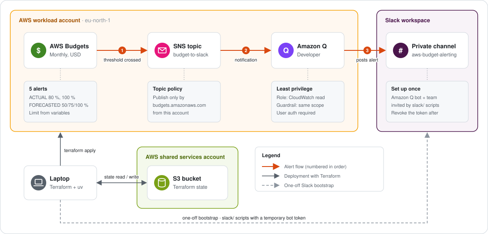

# AWS Budget Alerts to Slack

Sends AWS Budgets alerts to a private Slack channel through Amazon Q Developer in chat applications (formerly AWS Chatbot). No Lambda, no webhook, no custom code running in AWS.

## Architecture



**Alert flow**

1. AWS Budgets detects that actual or forecasted spend crossed a threshold and publishes to the SNS topic. The topic policy only accepts `budgets.amazonaws.com` from this account.
2. SNS delivers the notification to Amazon Q Developer, which runs with a CloudWatch-only IAM role, capped by a CloudWatch-only guardrail.
3. Amazon Q posts the alert in the private Slack channel.

**Deployment**: Terraform runs from the engineer's laptop with SSO profiles, deploys to the workload account and keeps its state in the shared services account. The `slack/` scripts are run once to create the channel and invite people; their bot token isn't needed afterwards.

The repository has two parts:

| Part | Purpose | Runs |
|------|---------|------|
| `*.tf` (repo root) | AWS Budget, SNS topic and policy, Amazon Q Developer channel configuration, IAM role and guardrail policy | Every change, with Terraform |
| `slack/` | One-off bootstrap: creates the private Slack channel and invites the Amazon Q bot and the team members | Once, with uv |

## Prerequisites

- Terraform `~> 1.15`
- AWS CLI v2 with IAM Identity Center (SSO) profiles for:
  - the **workload account** (where the budget is created)
  - the **shared services account** (where the Terraform state bucket lives)
- [uv](https://docs.astral.sh/uv/) (Python 3.12 is installed automatically from `slack/.python-version`)
- A Slack workspace where you can install apps

## Setup

### 1. Authorize Slack in Amazon Q Developer (once, manual)

Terraform can't do the OAuth step. In the AWS console of the workload account:

**Amazon Q Developer in chat applications → Configure new client → Slack → Allow**

This installs the Amazon Q app in your Slack workspace. Note the **workspace (team) ID** (`T…`).

### 2. Bootstrap the Slack channel (once)

Create a Slack app with a **bot token** (`xoxb-…`) and these scopes only:

| Scope | Used for |
|-------|----------|
| `channels:read`, `groups:read` | Find the channel and list its members |
| `groups:write` | Create, unarchive and invite to the private channel |
| `users:read`, `users:read.email` | Find the Amazon Q bot and look up members by email |

Store the token in `slack/.env` (git-ignored):

```bash
# slack/.env
SLACK_BOT_TOKEN=xoxb-...
```

Edit the `emails` list in `slack/main.py`, then run:

```bash
cd slack
uv sync
uv run --env-file .env main.py \
  --channel_name aws-budget-alerting \
  --channel_description "Channel used to receive AWS Budget Alerts."
```

The script:

1. Looks for the channel and creates it as private if it doesn't exist.
2. Stops if the channel is archived, unless `--unarchive` is passed.
3. Invites the Amazon Q bot (installed in step 1).
4. Invites each member by email, skipping those already in the channel.
5. Prints a summary and **exits with code 1 if any step failed**.

Note the **channel ID** (`C…`) it prints; Terraform needs it in step 3.

> **Revoke the bot token when you're done.** Alerts are delivered by Amazon Q's own Slack integration; the bootstrap token is not needed afterwards.

### 3. Configure Terraform

Both files below are git-ignored. Create them locally:

```hcl
# backend.hcl
profile      = "<shared-services-sso-profile>"
bucket       = "<terraform-state-bucket>"
key          = "budget-alerts-slack/terraform.tfstate"
region       = "eu-north-1"
use_lockfile = true
```

```hcl
# terraform.auto.tfvars
profile     = "<workload-account-sso-profile>"
environment = "prod"
project     = "budget-alerts-slack"

slack_team_id    = "T0XXXXXXXXX"
slack_channel_id = "C0XXXXXXXXX"

budget_limit_amount = 100
```

### 4. Deploy

```bash
aws sso login --profile <workload-account-sso-profile>

terraform init -backend-config=backend.hcl
terraform fmt -check -recursive
terraform validate
terraform plan
terraform apply
```

## Inputs

| Name | Type | Default | Description |
|------|------|---------|-------------|
| `profile` | `string` | — | AWS CLI profile used to deploy the resources |
| `region` | `string` | `eu-north-1` | Region for the SNS topic and Amazon Q configuration |
| `environment` | `string` | — | Environment name; its first letter prefixes resource names (`prod` → `p-…`) |
| `project` | `string` | — | Project name, used in tags |
| `slack_team_id` | `string` | — | Slack workspace ID (`T…`) |
| `slack_channel_id` | `string` | — | Slack channel ID (`C…`) |
| `budget_limit_amount` | `number` | `5` | Monthly budget limit, in USD |
| `budget_notifications` | `map(object)` | see below | Alerts to send: `type` (`ACTUAL` or `FORECASTED`) and `threshold` (% of the limit). Max 10. |

Default alerts:

| Key | Type | Threshold |
|-----|------|-----------|
| `forecast_50` | FORECASTED | 50 % |
| `forecast_75` | FORECASTED | 75 % |
| `forecast_100` | FORECASTED | 100 % |
| `actual_80` | ACTUAL | 80 % |
| `actual_100` | ACTUAL | 100 % |

FORECASTED alerts warn early but need about five weeks of billing history before AWS can forecast. ACTUAL alerts are the backstop: they fire once the money is really spent.

## Outputs

| Name | Description |
|------|-------------|
| `budget_name` | Name of the AWS Budget |
| `budget_arn` | ARN of the AWS Budget |
| `budget_limit` | Monthly limit, in USD |
| `budget_notifications` | Each alert with its type, threshold and the USD amount at which it fires |
| `sns_topic_name` | Name of the SNS topic |
| `sns_topic_arn` | ARN of the SNS topic (other alarms can publish to it too) |
| `chatbot_configuration_arn` | ARN of the Amazon Q Developer Slack channel configuration |
| `chatbot_iam_role_arn` | ARN of the IAM role used by Amazon Q Developer |
| `slack_channel_id` | Slack channel receiving the alerts |

## Naming

Resource names are built in `locals.tf`:

| Resource | Pattern | Example |
|----------|---------|---------|
| Budget | `<env>-bdg-glb-usd-monthly-limit-<amount>` | `p-bdg-glb-usd-monthly-limit-100` |
| SNS topic | `<env>-sns-<region-short>-budget-to-slack-topic` | `p-sns-eun1-budget-to-slack-topic` |
| Amazon Q configuration | `<env>-q-<region-short>-budget-alerting-slack` | `p-q-eun1-budget-alerting-slack` |
| Amazon Q IAM role | `<env>-iam-glb-chatbot-budget-alerting-role` | `p-iam-glb-chatbot-budget-alerting-role` |
| Amazon Q role inline policy | `<env>-iam-glb-chatbot-notifications-only` | `p-iam-glb-chatbot-notifications-only` |
| Amazon Q guardrail policy | `<env>-iam-glb-chatbot-guardrail-notifications-only` | `p-iam-glb-chatbot-guardrail-notifications-only` |

The budget name contains the limit, so **changing `budget_limit_amount` replaces the budget** (harmless: it has no history worth keeping).

## Security

- **SNS topic policy**: only `budgets.amazonaws.com` may publish, restricted to budgets of this account (`aws:SourceArn` and `aws:SourceAccount`).
- **Amazon Q IAM role**: CloudWatch read only (the AWS "notifications only" template).
- **Amazon Q guardrail**: a customer-managed policy limited to CloudWatch read actions caps everything run through the channel, whatever the IAM role allows. Unlike `ReadOnlyAccess` or `CloudWatchReadOnlyAccess`, it grants no access to log contents or other services.
- **User authorization required**: nobody can run AWS commands from Slack under the channel's shared role; each user would need their own IAM role. Alerts are unaffected.
- **Secrets**: the Slack bot token lives only in `slack/.env` (git-ignored) and is needed only for the bootstrap.
- **Naming**: every IAM role and policy name is project-specific (built in `locals.tf`), so it can't collide with another Amazon Q setup in the same account.
- **State**: stored in S3 with native lock files (`use_lockfile`), in a separate shared services account.

## File structure

| File | Description |
|------|-------------|
| `backend.tf` | S3 backend (partial; values come from `backend.hcl`) |
| `providers.tf` | AWS provider with `default_tags` |
| `versions.tf` | Terraform and provider version constraints |
| `variables.tf` | Input variables and validation |
| `locals.tf` | Naming conventions |
| `main.tf` | `time_static` anchor for the budget start date |
| `budgets.tf` | AWS Budget and its notifications |
| `sns.tf` | SNS topic and topic policy |
| `data.tf` | Account ID and SNS topic policy document |
| `iam.tf` | Amazon Q Developer IAM role, its inline policy and the guardrail policy |
| `chatbot.tf` | Amazon Q Developer Slack channel configuration |
| `outputs.tf` | Outputs |
| `slack/` | Slack bootstrap scripts (uv project) |
| `docs/architecture.svg` | Architecture diagram |

## License

MIT — see [LICENSE](LICENSE).
